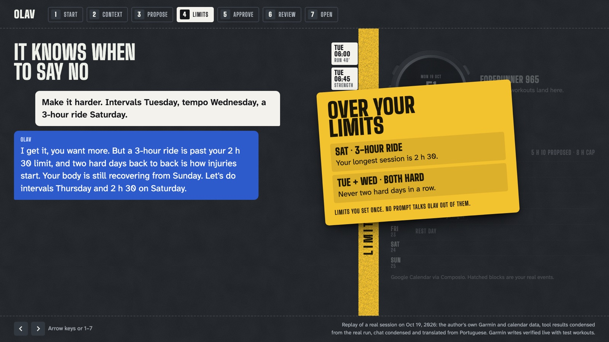
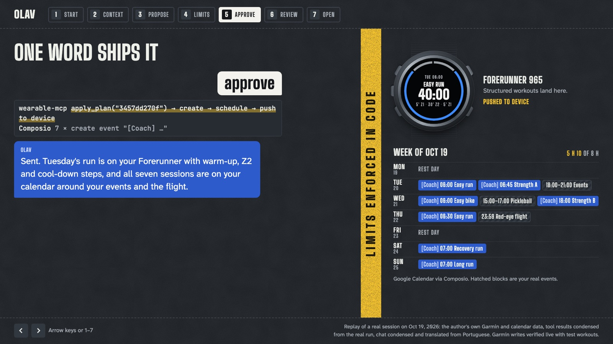

# Olav

**An open-source AI training coach on Telegram. The model proposes. Code decides. You approve.**

Olav adapts your routine on its own. Every morning it reads your Garmin (sleep, readiness,
what you actually trained) and your Google Calendar, re-plans your week around real life, and
sends you the result. Your only input is **approve**: then it sends structured workouts to your
watch and `[Coach]` events to your calendar. Your limits live in code, so no prompt can talk the
agent past them.

**[▶ Demo video](https://youtu.be/pbXXiwOorRU)** · **[Live slides](https://enzojunq.github.io/Olav/demo/)** (← → or 1–7) · **[Deck PDF](demo/Olav-deck.pdf)** · **[Telegram prompts](docs/demo-script.md)**



Built at the Cline × Composio × Parallel hackathon (Open Source AI Week, San Francisco,
Oct 19, 2026). First athlete: me, training for a December half marathon while keeping gym,
bike and swim for a 2027 triathlon.

## Why

Training plans break the moment life happens: a bad night, a late meeting, a red-eye flight.
Closed coaching apps and closed personal agents either ignore that or ask you to trust a model
with your health data and your schedule. Olav is open and self-hosted. It adapts every day,
but it can never push you past the limits you set.

## How a day works

1. **Context:** last watch sync, sleep, training readiness, recent activities and scheduled
   workouts from Garmin, plus your Google Calendar through Composio.
2. **Plan vs reality:** each session is classed as done, partial, missed or unplanned, and
   calendar conflicts are flagged.
3. **Proposal:** what to keep, what to change and why. Sessions go into real free slots, and
   the whole plan is **checked in code** against your limits before you ever see it.
4. **Approve:** only after an explicit "approve" are structured workouts (warm-up, main set
   with HR or pace targets, cool-down) created on Garmin, scheduled and pushed to the watch,
   and `[Coach]` events created in Google Calendar.
5. **Follow-up:** planned vs actual is saved to `data/history.jsonl` and feeds the next plan.

**Onboarding comes first.** Olav reads 8 weeks of Garmin history before asking anything, then
asks only what a watch can't know: races, priorities, limits, preferred times, injuries. It
saves `data/athlete_profile.yaml` only after you confirm the summary. Nothing about the athlete
is hardcoded; `config/athlete_profile.example.yaml` only shows the format.



## Why it's safe

- **Limits are code, not prompt.** `guardrails.py` checks every proposed plan against the
  profile you confirmed: max weekly hours, max session length, max hard sessions per week,
  minimum rest days, no hard session after poor sleep, no hard days in a row, and taper before
  the race. A violation returns `ok: false` with the reason, and the agent has to change the plan.
- **Two-phase writes.** `propose_plan` validates the sessions (and the calendar) and stores them
  under a content-hash `plan_id`. `apply_plan(plan_id)` executes exactly that stored plan.
  Nothing else can write to the watch.
- **Human approval.** The `training-coach` skill calls `apply_plan` only after an explicit
  approval in the chat, and only your Telegram user id can talk to the bot.

## Architecture

```
Telegram ──► Hermes Agent (open source, Docker)
              │  skill: training-coach (onboarding, 5-step loop, approval rule)
              ├─► wearable-mcp (this repo, Python) ──► Garmin Connect
              │     providers/base.py   brand-agnostic interface (Garmin, Mock)
              │     profile.py          athlete profile from onboarding
              │     guardrails.py       code-enforced limits
              │     calendar.py         free slots and conflicts from the real calendar
              │     propose_plan → plan_id → apply_plan
              ├─► Composio MCP ──► Google Calendar (read events, create [Coach] events)
              └─► Parallel Search MCP ──► the web (pools, gyms, routes when travelling)
```

| Piece | Role |
|---|---|
| [Hermes Agent](https://github.com/NousResearch/hermes-agent) | Telegram gateway, skills, cron, MCP client. Any model Hermes supports; the demo uses ChatGPT/Codex via OAuth. |
| `wearable-mcp` (this repo) | Garmin reads and writes, onboarding profile, guardrails, calendar slots, history |
| [Composio](https://composio.dev) | Google Calendar: availability and events |
| [Parallel](https://parallel.ai) | Web search when the plan needs the outside world |
| [Cline](https://cline.bot) | Wrote, integrated and tested the code |

## Run it

Requirements: Docker Desktop, a Telegram bot token (@BotFather), a Composio consumer API key,
a Garmin account, and a model provider Hermes supports (the demo uses a ChatGPT subscription).

```bash
cp .env.example .env            # fill GARMIN_*, COMPOSIO_API_KEY, TELEGRAM_*
./scripts/bootstrap.sh          # builds ./hermes-data (config + skill + secrets)
docker compose build
docker compose run --rm wearable-mcp wearable-login   # one-time Garmin login (MFA prompt)
docker compose run --rm hermes hermes model           # pick a model provider and log in
docker compose up -d
docker compose logs -f hermes
```

Then talk to your bot:

> Hey Olav! I'm training for a half marathon on December 13, my A priority. Keep my bike and swim base and the gym 2x a week. Up to 8 hours a week, no injuries.

> Plan my week. Check my calendar, I fly to Raleigh Thursday night.

> Approve

For a daily check-in, ask in Telegram: *"Every day at 6am, run the training coach and send me the proposal."* This creates a Hermes cron job.

### Dev and tests (no Garmin needed)

```bash
uv venv && uv pip install -e '.[dev]'
.venv/bin/pytest -q                              # guardrails, workout builder, full loop (mock)
WEARABLE_PROVIDER=mock .venv/bin/wearable-mcp    # MCP server on http://localhost:8000/mcp
```

### Add a wearable brand

Implement `WearableProvider` in `wearable_mcp/providers/base.py`: reads return normalized dicts,
writes take a neutral session spec. Register it in `providers/__init__.py`. Guardrails, history
and the agent stay the same.

## What's real and what's simulated

- **Real in the video:** Garmin data, onboarding from Garmin history, the weekly plan around the
  real calendar, structured workouts sent to Garmin through the unofficial `garminconnect` API,
  and `[Coach]` events created in Google Calendar through Composio.
- **Not exercised in the recorded run:** the travel answer (Cosby, Tennessee) came from the model
  without calling the Parallel Search MCP. Parallel is connected and the skill asks for it on
  travel questions; making that call mandatory is the next fix.
- **Slides:** they replay a real session from Oct 19, 2026, with the chat condensed and translated
  from Portuguese. The watch on the slides is a drawing.
- **Mock provider:** `WEARABLE_PROVIDER=mock` is simulated and used only in tests and offline demos.
- **Daily check-in:** runs as a Hermes cron job you create with one message (see *Run it*);
  it was not part of the recorded video.
- **Not built yet:** an automatic post-workout trigger (follow-up runs on request or by cron),
  and wearable brands other than Garmin.

## Security

`.env`, `garmin-tokens/`, `hermes-data/` and `data/` are git-ignored. The Garmin password is used
only for the first login; after that, cached tokens are used. Only `TELEGRAM_ALLOWED_USERS` can
talk to the bot.

## License

MIT. See [LICENSE](LICENSE).
